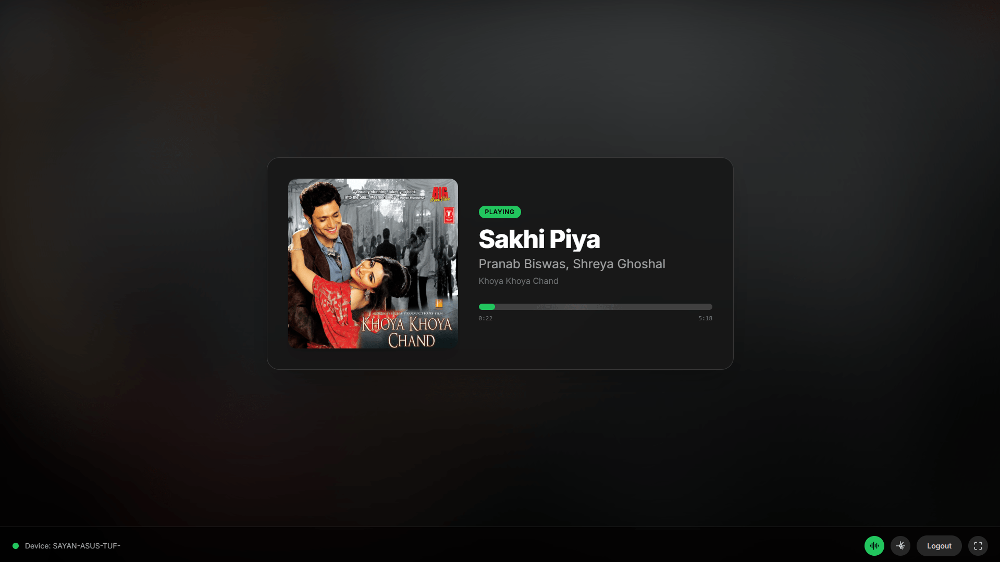
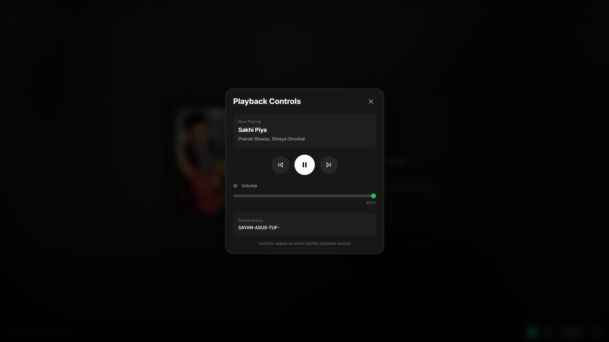

<p align="left">
  
</p>

# 🎵 SpotDeck: Spotify Now Playing Dashboard

**SpotDeck** is a sleek, animated "Now Playing" dashboard inspired by the concept of a dedicated media display (like the discontinued Spotify Car Thing). It transforms any spare device—a tablet, a secondary monitor, or a spare phone—into a beautiful, interactive music display with real-time album art ambience and playback controls.

## ✨ Features

  * **Real-Time Playback Info:** Displays the current track's title, artist, album, and progress.
  * **Animated Visuals:** Smooth crossfade transitions, progress bar shimmer, and a dynamic, color-matched ambient background and album art glow based on the current track's album art.
  * **Full Playback Controls:** Integrated buttons for Play/Pause, Skip Next, Skip Previous, and Volume Control (requires Spotify Premium and an active device).
  * **Device Status:** Shows the connected device and its online/offline status.
  * **Fullscreen Mode:** Dedicated fullscreen button and keyboard shortcut (`F` or `f`).
  * **Keyboard Shortcuts:** Control playback with the spacebar, and toggle fullscreen with `F`.
  * **Secure PKCE Authentication:** Uses modern, secure Proof Key for Code Exchange (PKCE) for Spotify authorization without exposing a client secret.

## 👀 Preview





## 🛠️ Setup Instructions (GitHub Pages & Private Repo)

To host your SpotDeck securely using GitHub Pages from a private repository, you need to set up a Spotify Developer Application and configure the deployment.

### Step 1: Create a Spotify Developer Application

1.  Go to the [Spotify Developer Dashboard](https://developer.spotify.com/dashboard/).
2.  Click **Create app**.
3.  Fill in the App Name (e.g., `SpotDeck`), Description, and check the box for `Web API`.
4.  Click **Create**.
5.  In your new app's settings, find the **Client ID** and keep it handy.
6.  Click **Edit Settings**.
7.  Under **Redirect URIs**, add the following URL. This URL is crucial and must exactly match the path of your GitHub Pages site:
    ```
    https://<YOUR-GITHUB-USERNAME>.github.io/<YOUR-REPO-NAME>/
    ```
    *Example: `https://johndoe.github.io/spotdeck-display/`*
8.  Click **Add** and then **Save**.

### Step 2: Configure Your GitHub Repository

1.  **Create a New Private Repository** on GitHub (e.g., `spotdeck-display`).
2.  **Upload the `index.html` file** (the provided file) to the root of this new repository.

### Step 3: Insert Your Client ID

1.  Open the `index.html` file in your GitHub repository editor (or locally).
2.  Find the line near the top of the `<script>` tag:

    ```
    const SPOTIFY_CLIENT_ID = "YOUR_SPOTIFY_CLIENT_ID_HERE";
    ```
    
4.  **Replace** `"YOUR_SPOTIFY_CLIENT_ID_HERE"` with the actual **Client ID** you obtained in Step 1.
5.  **Commit** the changes to your repository.

### Step 4: Configure GitHub Pages Deployment

To enable GitHub Pages on a **private** repository, you must use a specific setup, typically deploying from the `main` branch.

1.  In your GitHub repository, go to **Settings**.
2.  In the left sidebar, click **Pages**.
3.  Under **Build and deployment**, select:
      * **Source:** **Deploy from a branch**
      * **Branch:** Select the **`main`** branch and the **`/ (root)`** folder.
4.  Click **Save**.
5.  GitHub will now deploy your site. This may take a few minutes. Once deployed, the URL will be displayed on this page (it will be the same URL you entered as the Redirect URI in Step 1).

### Step 5: Final Authorization

1.  Navigate to your deployed GitHub Pages URL (e.g., `https://<YOUR-GITHUB-USERNAME>.github.io/<YOUR-REPO-NAME>/`).
2.  Click the **Connect Spotify** button.
3.  You will be redirected to the Spotify login page to authorize the application.
4.  After authorization, you will be redirected back to your SpotDeck display, and it will begin showing your current playback status.

## 💻 Keyboard Shortcuts

| Key | Action | Notes |
| :--- | :--- | :--- |
| **Space** | Play/Pause | Only works when the Settings Modal is closed. |
| **F** / **f** | Toggle Fullscreen | |
| **Escape** | Close Settings Modal | |
| **V** / **v** | Toggle Visualizer | |

## ⚠️ Requirements

  * **Spotify Premium:** Playback control functions (Play/Pause, Skip, Volume) require a **Spotify Premium** subscription due to Spotify API restrictions.
  * **Playback device:** Use another active Spotify Connect device in controller mode, or start the local browser player described below.

## Browser playback and Vibe Face settings

### Halloween Party Edition

Open **Einstellungen → Party & Halloween** to enable **Halloween-Modus** and/or **Party-Modus**. Both default off and are saved locally. Halloween adds a violet/orange glass palette, optional quiet fog/moon decoration and ten brief, cute scenes. Only one larger scene runs at a time. **Halloween-Effekte** controls the pause between scenes; **Automatische Überraschungen** and **Ambient-Hintergrund** can be switched off separately. Five taps use pumpkin/ghost confetti when Halloween is enabled.

Party mode hides **all** player controls after eight seconds, including **Party-Modus beenden**. The face then grows smoothly over about 650 ms into the freed space: tested Full HD size increases from 566 to 690 px, and 4K from 880 to 1240 px. Cover and metadata stay visible. Mouse movement, touch or the first key reveals the controls and restores the prior size. Hidden controls are inert; a held wake key cannot accidentally activate an action. Escape exits Party when no dialog is open. Arrow keys provide spatial navigation where the browser forwards remote-control keys. Existing fullscreen and Wake Lock remain available; Party mode does not force fullscreen.

Dance now has more visible jumps, landing compression, alternating tilt and optional bounce/sway/shuffle patterns. Existing Normal/Lively/Reduced motion settings remain in place. Spotify uses autonomous animation: no protected Spotify audio is captured or analysed, no inaccessible audio-features endpoint is assumed, and no preset tempo is labelled as detected. Spotify lyrics remain readable without synchronized face cues or line highlighting, in accordance with the synchronization restriction described in the [Spotify policy](https://developer.spotify.com/policy).

**Tempo & Musikdaten** automatically searches the free, keyless MusicBrainz/AcousticBrainz APIs for recording-specific BPM metadata. ISRC, version, artist and duration are checked; missing or ambiguous recordings are never shown as confident detection. AcousticBrainz is an archive with no new data collection since 2022, so coverage is limited. Database BPM do not synchronize Spotify audio or set its animation clock. No API account, backend or paid infrastructure is needed. Results are cached; rate limits and temporary outages are shown clearly.

The closed **Eigene Musik & Tempo selbst korrigieren** section retains the local audio file test for which you hold the required synchronization rights. Select audio, confirm those rights, optionally import a matching `.lyricsfile.yaml` or `.lrc`, then start the test. Spotify is paused first; a failed pause blocks the test. Files stay in the browser. Automatic local analysis is preferred; tap tempo, manual BPM, half/double speed and offsets are optional corrections. Actual word timestamps remain distinct from estimates. Stopping the test does not automatically resume Spotify.

Lyrics search now tries an exact LRCLIB lookup, flexible searches and a base-title fallback. A different recording version is labelled. When several compatible text versions remain, SpotDeck automatically picks the best match, preferring safely synchronized lyrics. The selection menu remains available for corrections and remembers manual choices across normal reloads. Refresh, local `.txt`/`.lrc`/YAML files, expiry-based caching and stale-request cancellation are supported. Original-version timestamps are never copied onto a Remix. See [Party behavior, provider comparison, matching and verification](docs/party-lookups.md).

The diagnostic labels source, raw and dance BPM, confidence and offset. An estimate is not an accuracy guarantee. The generated 120-BPM browser test yielded about 120.5 BPM; real music can require manual adjustment. See [timing findings, implementation, policy decisions and verification](docs/halloween-timing.md) for details. The pinned YAML parser and its license are bundled in the standalone HTML; there is no new external runtime dependency.

### Glass interface and responsive face

The interface uses a shared CSS glass material for navigation, the floating playback dock and settings. Clear controls, regular surfaces and a more opaque dialog share light edges, reflections and shadows. Album artwork remains unfiltered inside cards; the existing blurred artwork still supplies the background colors. No additional rendering loop is used for the glass treatment. Design references: [Apple Materials](https://developer.apple.com/design/human-interface-guidelines/materials) and [CSS backdrop-filter](https://developer.mozilla.org/en-US/docs/Web/CSS/Reference/Properties/backdrop-filter).

**Einstellungen → Vibe-Face-Größe** offers Normal, Groß (default) and Extra groß, with upper limits of 480, 570 and 650 CSS pixels. These are limits, not fixed dimensions: the face uses its container's available width and height and keeps a square aspect ratio. Smaller screens and short landscape windows automatically shrink it. The panel reserves movement/effect space, SVG accessories scale with the face, and a ResizeObserver adjusts translation amplitude without adding another animation loop or replacing the existing transform variables.

**Glas & Transparenz → Reduzierte Transparenz** saves an explicit, more opaque appearance and removes surface blur. The system transparency preference is also respected when supported. Browsers without backdrop-filter get more opaque materials automatically. Motion preferences and optional sounds retain their existing behavior.

All appearance preferences persist locally. The progress track supports click/touch and Arrow keys (5 seconds), Home and End. Playlist cards, saved tracks and synchronized lyric lines accept Enter/Space. Settings place focus in the dialog, contain Tab navigation and return focus when closed. Long song titles wrap; on very short screens their metadata area can scroll instead of moving the playback dock out of view.

#### Layout verification, 2026-10-30

The Chromium-based in-app browser was checked with generated cover, track, library and synchronized-lyrics data, without a Spotify account. All six requested viewports had no horizontal page overflow; all main and navigation buttons remained visible and at least 44 × 44 CSS pixels.

| Viewport | Face square, Groß | Layout |
| --- | ---: | --- |
| 390 × 844 | 249 px | Cover, metadata and face stacked; floating dock |
| 844 × 390 | 155 px | Compact three-column landscape |
| 768 × 1024 | 376 px | Cover/metadata row, large face below |
| 1366 × 768 | 368 px | Cover, metadata and face in three columns |
| 1920 × 1080 | 566 px | Prominent desktop face |
| 3840 × 2160 | 570 px | Large-screen layout; Extra groß reaches 650 px |

Additional browser checks covered saved settings after reload, reduced transparency, dialog scrolling at 844 × 390, forward/backward focus containment, library cards, active lyrics, actual five-click Easteregg activation and visible confetti with a 650 px lively face. The offline integration suite also checks preference migration/validation, proportional motion scaling, keyboard seeking and dialog focus behavior. Separate Firefox, Safari, mobile operating systems, physical TV hardware and audible Spotify Premium playback have not been retested for this visual revision.

Open **Einstellungen → Wiedergabe**:

- **Andere Geräte steuern** keeps the existing controller mode. Choose an available Spotify Connect device in the device list to transfer the current playback; its play/pause state is preserved.
- **Auf diesem Gerät abspielen** prepares the official Spotify Web Playback SDK. Existing controller logins remain valid, but local playback requires reconnecting once to grant `streaming`, `user-read-email` and `user-read-private`. Then choose local playback again and press **Auf diesem Gerät starten**. No browser playback starts merely by opening the settings.
- Spotify Premium, HTTPS and browser support for protected media are required. The Spotify developer app must be configured for the Web Playback SDK. A local-device registration or mock test alone does not prove audible playback on a particular device.
- If playback is blocked by autoplay rules, press the start button again. On some systems, especially iOS, volume is controlled on the device itself.
- TV browsers are not guaranteed to support Spotify DRM, even if ordinary video works. When unsupported, keep controller mode or run SpotDeck on a mini-PC connected to the TV by HDMI.

The SDK is loaded only when local playback is requested. Tokens stay in the existing PKCE/session flow; no client secret or account credentials are embedded. A shared refresh operation prevents competing token refreshes. Logout disconnects the local player.

**Einstellungen → Vibe-Face-Bewegung** offers Systemstandard, Reduzierte Bewegung, Normale Animation and Lebhafte Animation. The default follows the operating system; explicitly choosing Normal or Lively overrides its reduced-motion preference. Reduced mode limits head movement while keeping expressions, lyrics and interactions available.

Vibe Face uses one animation loop for idle behaviour, dance, lyric mouth movements and the Easteregg. The loop pauses in hidden tabs and updates at approximately 30 fps (15 fps in reduced mode). It occasionally looks around, daydreams, yawns, crosses its eyes or briefly stumbles and recovers while dancing. These are original character gestures, inspired by playful small companions, not copied assets.

Single taps vary between shy, cheeky, happy and surprised reactions; shorter multi-tap sequences produce confused or playfully annoyed reactions. **Five taps/clicks** within 2.6 seconds, with gaps no longer than 650 ms, trigger seven seconds of Vibe Overdrive. Dragging, long presses, multi-touch and duplicate synthetic clicks do not count. Enter/Space on the focused face also work.

Optional quiet interaction sounds are disabled by default. Enable **Leise Fantasiegeräusche** to hear short, rate-limited electronic chirps. They use a separate low-volume audio source and do not process Spotify audio.

For the permitted local test source, Lyricsfile word timestamps drive singing when available; LRC line-only lyrics use conservative timing estimates. This is not phoneme recognition. Without lyrics or reliable tempo, autonomous expressions and dance remain available. Spotify audio-features requests and the old 620 ms tempo fallback are retired.

### Verification

Run the dependency-free, offline integration checks with:

```sh
node tests/spotdeck.test.cjs
node tests/halloween.test.cjs
node tests/lookups.test.cjs
```

They cover reduced-motion overrides, idle animation, one RAF loop, hidden-tab suspension, mouse/touch fallback, ghost clicks, the five-tap Easteregg, simulated SDK initialization and commands, transfer requests, metadata, library playback, scope upgrade and DRM/account fallback. No real account or token is used.

The Halloween suite adds scene lifecycle/exclusivity, priorities, bounded queues/timers, tempo folding, phase/transport behavior, tap/onset estimates, YAML validation, real-word/estimated timing, local audio controls and rights gates, Party hiding/wake/exit and source cleanup. Current browser and device-test limits are recorded in the timing document linked above.

On 2026-10-29 the actual Chromium-based in-app browser was checked at desktop and 844 × 390 viewports: settings, explicit normal motion with OS reduction enabled, idle reactions and five real mouse clicks passed. Firefox native automation was stopped by the testing tool's URL-policy limitation at its profile chooser. Separate Chrome/Edge, Safari, iOS, Android, smart-TV hardware and audible Premium playback have **not** been certified by these checks and need a device/account test.

Official references: [Web Playback SDK](https://developer.spotify.com/documentation/web-playback-sdk), [SDK reference and autoplay activation](https://developer.spotify.com/documentation/web-playback-sdk/reference), [required player scopes](https://developer.spotify.com/documentation/web-playback-sdk/howtos/web-app-player/).

## 📃 License

MIT License © 2025 Sayan Sarkar

## 🤝 Contributions 
Special Thanks To [Shitij](https://github.com/ShitijHalder) For The Overall Help.


## TV performance and playback diagnostics

Settings → Darstellung now offers Auto, Quality and TV/Performance profiles plus opt-in local diagnostics. Local SDK state events bypass REST latency; serialized, revision-guarded polling supplies fallback/reconciliation. Lyrics use a compact source line and a ⋯ menu for details/local files. Reduced-motion confetti uses independent ring coordinates. See [implementation, verification limits and device comparison steps](docs/tv-performance.md). All three offline suites pass; actual TV audio gaps, paint cost and new browser layouts still need device testing.


## Lyrics timing update

Matching synchronized LRCLIB lyrics now take priority over plain text. They follow Spotify playback position, pause and seeking; different versions or unconfirmed timing remain plain. Spotify app lyrics are not available via the public API. The change supersedes older statements about static Spotify lyric display; autonomous Vibe Face behavior stays unchanged. See [lyrics matching and tests](docs/lyrics-sync.md).


The synchronized lyric timeline also drives Vibe Face singing again, even with the text view closed. Lyrics load in the background and transient errors retry with backoff. Word-level timing is used when available; mouth timing within line-only lyrics is estimated. The dance remains independent.


Lyrics service errors now distinguish overload, rate limits and connection/timeout failures. Refresh failures keep matching cached lyrics and singing timestamps; retries use growing waits with jitter while honoring the provider delay. See the [availability notes](docs/lyrics-sync.md).


The Memories regression fixes title matching with parenthesized guest-artist credits, rechecks old static-cache choices and reads line-timed YAML fallback. Spotify lyrics can also trigger word-reaction props again, with memory-themed scenes added. See [specific reproduction and verification limits](docs/lyrics-sync.md).

Mouth morphing, lyric-driven vocal targets and Halloween movement now share the body animation cadence: up to 60 updates/s in quality/automatic quality and 30 in TV mode. Automatic mode can still reduce effects after measured slow frames. Reduced-motion and hidden-tab behavior are retained. The changing mouth no longer carries a drop-shadow filter, and moving Halloween properties are scoped to the effect layer. See [verification and limits](docs/lyrics-sync.md).
